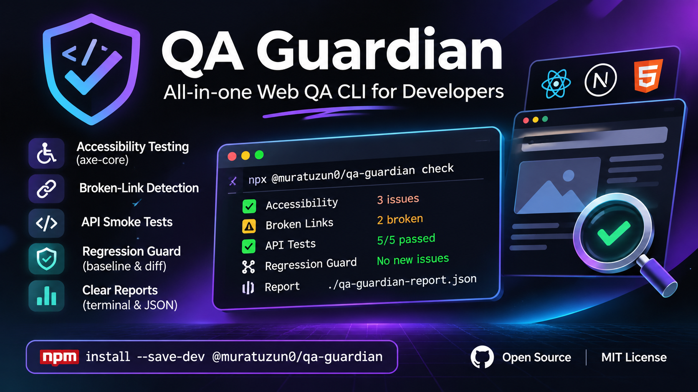

*The banner shows illustrative terminal output.*

# QA Guardian

[](https://github.com/Muratuzun0/qa-guardian/actions/workflows/ci.yml) [npm package](https://www.npmjs.com/package/@muratuzun0/qa-guardian)

QA Guardian is a TypeScript CLI for checking a running web application before deployment. It checks page availability, links, accessibility, and simple REST API expectations in one run. Regression Guard can fail a run on newly introduced findings while keeping existing issues visible. It works with Next.js, React, and static sites. Checks and comparisons run locally.

QA Guardian uses Playwright and axe for rendered-page checks and adds scoped HTTP checks, a shared report, and a local regression baseline. Use Playwright tests directly for custom user journeys, app-specific assertions, and control over the exact page state you scan.

## Requirements

- Node.js 22 or 24
- Chromium installed through Playwright for browser checks
- A running application or preview deployment

## Install and run

From your application directory, install the published package and Chromium.

```sh
npm install --save-dev @muratuzun0/qa-guardian
npx playwright install chromium
```

On Linux CI, use `npx playwright install --with-deps chromium` to install Chromium and its system dependencies. With your app running at `http://localhost:3000`, run a check without creating a configuration file. The CLI checks `/` by default. Use `--url` if your app is listening at a different address.

```sh
npx qa-guardian check
npx qa-guardian check --url http://localhost:3000
```

Run `init` in the application directory to create `qa-guardian.config.json`. Edit the routes to match your application. API checks run only for endpoints you configure.

```sh
npx qa-guardian init
npx qa-guardian check
```

## Try the React demo

This community workshop site starts with a missing image alternative and a broken recording link. The second scenario fixes the decorative image with `alt=""` and adds a new broken link to a partner guide. The recording link stays broken.

From a checkout of this repository, run the demo with the published CLI pinned to `0.1.0`.

```sh
cd examples/react-launch
npm ci
npx playwright install chromium
npm run demo
```

The demo saves a real baseline with `check --save-baseline`, then compares the revised site with `check --baseline`. It prints this summary from the CLI’s JSON reports.

```text
Baseline (exit 1)
  accessibility /: image-alt
  links /workshop-recording: Link returned HTTP 404.
Comparison (exit 1)
  new: links /partner-guide: Link returned HTTP 404.
  resolved: accessibility /: image-alt
  unchanged: links /workshop-recording: Link returned HTTP 404.
```

The CLI’s comparison exits 1 because the new link fails the threshold. The demo script exits 0 when the expected findings match. For a manual run and full terminal output, follow the [React demo walkthrough](examples/react-launch/README.md).

## Configure the checks

Save this example as `qa-guardian.config.json` and replace the routes and API assertion with ones your application serves.

```json
{
  "baseUrl": "http://localhost:3000",
  "routes": ["/", "/about"],
  "checks": {
    "pages": true,
    "links": true,
    "accessibility": true,
    "api": true
  },
  "timeoutMs": 10000,
  "links": {
    "externalOrigins": [],
    "concurrency": 4,
    "maxLinksPerPage": 100,
    "checkFragments": true
  },
  "browser": { "headless": true },
  "api": [
    {
      "path": "/api/health",
      "method": "GET",
      "expectedStatus": 200,
      "assertions": [{ "path": ["status"], "equals": "ok" }]
    }
  ],
  "allowUnsafeMethods": false,
  "reportDir": "qa-guardian-reports",
  "failOn": "error"
}
```

See the [configuration reference](docs/configuration.md) for target restrictions, API headers, and failure thresholds.

## Run checks and read results

```sh
npx qa-guardian check --config qa-guardian.config.json
npx qa-guardian check --json
npx qa-guardian --help
npx qa-guardian --version
```

The terminal report identifies the check, affected URL, result, and duration. Accessibility findings include the axe rule identifier, impact, affected selectors, and rule guidance. Use `--json` to send the structured report, including severity, to standard output. Set `reportDir` to also write `qa-guardian-report.json` locally.

| Exit code | Meaning |
| --- | --- |
| 0 | Results are below the configured failure threshold. |
| 1 | A check result meets the configured failure threshold. |
| 2 | An execution error occurred, such as invalid configuration, a missing browser, or a report write failure. |

## Catch new failures with Regression Guard

An existing app may already have failing checks. Record the current findings, review the baseline, and run the same checks with it on subsequent changes.

```sh
npx qa-guardian check --save-baseline
npx qa-guardian check --baseline
```

The first command creates `.qa-guardian-baseline.json` in the working directory. It can write a baseline and still exit 1 if the run finds failures at your threshold. The second command keeps known findings visible and exits 1 only for new findings at your threshold. Execution errors still exit 2. Review baseline changes like configuration changes, and use the reviewed file in CI.

See the [Regression Guard guide](docs/regression-guard.md) for comparison rules and limitations.

## Run in GitHub Actions

The following GitHub Actions step runs the bundled preview after setting up Node.js and running `npm ci`. For your own app, install QA Guardian as a dev dependency, replace the preview command with your app's start command, and use `npx qa-guardian check` to read your project's default configuration.

```yaml
- name: Check the preview
  shell: bash
  run: |
    npx playwright install --with-deps chromium
    npm run build
    node examples/preview.mjs &
    server_pid=$!
    trap 'kill "$server_pid" 2>/dev/null || true' EXIT
    curl --fail --silent --show-error --retry 20 --retry-connrefused \
      --retry-delay 1 --max-time 5 http://127.0.0.1:3000/ >/dev/null
    node dist/cli.js check --config examples/qa-guardian.config.json
```

## Troubleshooting

- **Connection failed.** Start the application, then check the URL and port from the same shell or CI runner.
- **Chromium could not start.** Run the Playwright installation command for your platform. To use an existing Chromium installation, set `QA_GUARDIAN_CHROMIUM_PATH` to its executable. To run without Chromium, set `checks.links` and `checks.accessibility` to `false`.
- **A route timed out.** Check that the server finished starting and serves the route directly. Increase `timeoutMs` for routes that legitimately take longer.
- **A report could not be written.** Set a writable relative `reportDir` under the working directory.
- **Configuration is invalid.** Fix the setting named in the error and verify that the file is JSON.

## Limitations

QA Guardian runs checks against configured routes. It does not exercise sign-in flows, clicks, form submissions, or other user journeys. Link checks are bounded and use explicit external origins. Browser checks inspect the initial loaded page. They block cross-origin resources, WebSockets, and service workers. A page that depends on those features may render differently during a check.

Automated accessibility results cover only the rules and page states that the engine can evaluate. WCAG conformance requires broader evaluation, including manual keyboard and assistive technology testing.

## Develop and contribute

Run the development checks from the checkout.

```sh
npm ci
npx playwright install chromium
npm run typecheck
npm run lint
npm test
npm run build
node dist/cli.js --help
```

Read [CONTRIBUTING.md](CONTRIBUTING.md) for contribution guidance, [SECURITY.md](SECURITY.md) for vulnerability reporting, and the [architecture notes](docs/architecture.md) for scope and design decisions. The [roadmap](docs/roadmap.md) lists small improvements that contributors can verify locally.

## License

[MIT](LICENSE)
